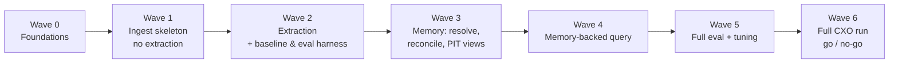

# MVP Plan — Announcement Memory (local, Ollama)

Design background: [memory-design-brainstorm.md](./memory-design-brainstorm.md).

## 1. What the MVP must show

| # | Hypothesis | Pass criterion |
|---|---|---|
| H1 | **No duplication.** Repeated information is stored once and returned once | Duplicate rate in retrieved context ≤ 5%. Facts per extracted doc ≪ claims in the doc (target: ≥ 50% of candidate facts become CONFIRM/IGNORE, not ADD, on quarterlies) |
| H2 | **Trivial details stay out.** AGM venue, webcast, contacts and boilerplate don't appear in normal answers | T0/T3 content in default retrieval ≤ 2%. T3 questions ("where was the 2024 AGM?") still answerable when asked directly |
| H3 | **Point in time is correct.** Backtests can't see the future | **0** citations with `published_at > knowledge_date` across the eval set. Answers at `T` are identical before and after ingesting docs published after `T` |
| H4 | **Better than naive RAG.** Same or better answers with less context | Answer accuracy ≥ baseline chunk-RAG. Tokens in context ≤ 50% of baseline |
| H5 | **A local LLM is good enough and fast enough** | Valid JSON ≥ 98% after one retry. Quote-check pass ≥ 90%. Full CXO ingest finishes overnight on one GPU |

If H1–H4 pass on CXO, the approach is proven. H5 decides whether to stay local at 2,000-ticker scale or move extraction to a bigger model.

## 2. Scope

**In**
- One ticker: **CXO** (the only data available locally). Code is ticker-aware (`ticker` column everywhere), so adding tickers is just more data.
- Dev slice: **2025-01-01 → 2026-10-31 (136 docs)** for fast iteration. Then the full CXO history (1,316 docs) for the final run.
- Ingest one document at a time, in `published_at` order. Re-runs are safe, and every output records the extractor version.
- Point-in-time queries with `knowledge_date`.
- Agent query CLI + naive RAG baseline + eval harness.

**Out (deferred)**
- Linking entities across tickers
- Detecting revisions or contradictions
- Detailed financial statement extraction
- Cached point-in-time summaries
- Graph DB
- Postgres
- UI
- Multi-user
- User notes. Wire in a simple stub at the end only if time allows. Notes are used only when answering

## 3. Environment

| Item | Choice | Notes |
|---|---|---|
| Hardware | RTX 5070 Ti 16 GB | Both local models passed sequential requests; benchmark measured a 6.05 s full-quarterly chat call |
| LLM runtime | Ollama 0.40 at `http://localhost:11434` | Use `/api/chat` with `format=<JSON schema>` (structured output), `temperature=0`, `think=false` |
| Extraction model | `qwen3.5:9b` (default) | 262k context, so most docs need no chunking. Compare `gemma4` and `nimble` on the eval set (Wave 2, item 2.4) |
| Triage model | Same model first. Try a smaller or faster one only if triage is the bottleneck | |
| Embeddings | Local `qwen3-embedding` | Pulled for Wave 0; 4.7 GB, 4,096 dimensions. Compare with `bge-m3` / `nomic-embed-text` if retrieval quality or vector footprint is poor |
| Language | Python 3.13 + `uv` | Packages: `ollama`, `pydantic`, `sqlite-vec`, `typer`, `rich`, `datasketch` (or a hand-written 64-bit simhash) |
| Storage | Single SQLite file `var/memory.db` | Uses FTS5 for keyword search and `sqlite-vec` for vectors |

Ollama settings to pin in config:
- `num_ctx` (start at 32k and raise per doc when the input is longer)
- `keep_alive` (for example, `30m`) so the model doesn't reload for every document
- Run one request at a time. The pipeline is sequential per ticker anyway

## 4. Data loading facts (verified)

- `data/CXO/announcements/<YYYYMMDD-HHMM-Headline-ID>/` → contains `2.0.0/` (207 docs) and/or `1.0.0/` (1,284 docs).
- **Text:** use `2.0.0/*_v2.md` if present, otherwise `1.0.0/*.md`. Two folders have neither markdown nor metadata → report and skip text extraction.
- **Metadata:**
  - The v2 JSON has `source_metadata.{headline, published_at, category, announcement_types, is_price_sensitive}`.
  - The v1 JSON has a different schema (`headline`, `sections`, …) and may not include `published_at`, `category` or `is_price_sensitive`.
  - **Take `published_at` from the folder prefix** (`YYYYMMDD-HHMM`, UTC) for every doc. Read the other metadata fields when available.
- **Size:** about 26M characters in total (≈ 6.5M tokens). Median doc 6.5k characters, p90 47k, max 360k (the 2010 prospectus). Price-sensitive docs: about 12M characters.
- Ignore images (`.png`, `.jpeg`, `.jpx`) and `_middle.json`.

## 5. Code layout

```
agent-memory/
  pyproject.toml
  config.toml                 # models, num_ctx, thresholds, skip-list, paths
  src/
    agent_memory/
      loader.py                 # discover docs, choose v2/v1, parse folder date, metadata
      db.py                     # schema + migrations + PIT query helpers
      llm.py                    # Ollama client wrapper: chat_json(schema), embed(), retries, logging
      prompts/                  # triage.md, extract.md, judge_same.md, answer.md (versioned)
      pipeline/
        triage.py
        boilerplate.py          # paragraph split, simhash, running counters
        chunks.py               # chunk store, FTS5, embeddings
        xref.py                 # "Refer to ASX announcement …" → doc id
        extract.py              # facts + tier + evidence quote (cached)
        quotecheck.py
        resolve.py              # entity + attribute resolution
        reconcile.py            # ADD / CONFIRM / SUPERSEDE / IGNORE
        ingest.py               # one-doc orchestration, idempotent, transaction per doc, --replay
      query/
        pit.py                  # point-in-time views over facts/chunks
        retrieve.py             # routing, hybrid search, packing
        agent.py                # tool-using answer loop
        baseline_rag.py         # naive chunk RAG for comparison
    eval/
      questions.yaml            # gold Q&A (see §8)
      run_eval.py
    scripts/                    # bench.py, compare_models.py
    tests/
    var/                        # memory.db, logs, eval reports (git-ignored)
```

CLI:
```
am ingest --ticker CXO [--from 2025-01-01] [--to ...] [--limit N] [--reingest] [--version v1]
am ask "What is CXO's cash balance?" --ticker CXO [--as-of 2025-06-30] [--baseline]
am show doc <id> | fact <id> | entity <name> | timeline <entity> <attribute>
am eval [--as-of-sweep] [--model qwen3.5:9b]
am stats                       # docs by triage class, facts by action/tier, timings
```

## 6. Storage schema (MVP)

```sql
document(id TEXT PK, ticker, folder, headline, published_at, category, types_json,
         price_sensitive, text_path, triage_class, triage_reason,
         ingest_status, extractor_version, ingested_at, error)

doc_xref(src_doc, dst_doc, cited_title, cited_date, match_score)

paragraph_hash(scope, ticker, simhash, first_seen_at, doc_count, sample_text)

chunk(id PK, doc_id, ticker, published_at, ord, text, is_boilerplate)
chunk_fts  -- FTS5 over chunk.text
chunk_vec  -- sqlite-vec over chunk embedding

entity(id PK, ticker, type, canonical_name, first_seen_at)
entity_alias(entity_id, alias, first_seen_at, source_doc)

attribute(name PK, description, first_seen_at, status, merged_into)

fact(id PK, ticker, entity_id, attribute, value, value_num, unit, qualifier,
     as_of, period, fact_type, tier, salience, text, key_hash,
     first_seen_at, extractor_version)
fact_vec   -- sqlite-vec over fact.text embedding

extraction_cache(doc_id, model, prompt_version, output_json, created_at)  -- replay reconciliation without LLM
llm_call(id, step, doc_id, model, prompt_tokens, output_tokens, ms, ok, error, created_at)

fact_source(fact_id, doc_id, published_at, quote, action,      -- ADD|CONFIRM|SUPERSEDE
            supersedes_fact_id, role)                           -- origin|confirm|xref
```

Point-in-time rule, used by every query:
- Join through `fact_source` with `published_at <= :knowledge_date`.
- A fact is **current at T** if no `fact_source` row with `action='SUPERSEDE'` and `supersedes_fact_id = fact.id` has `published_at <= T`.

## 7. Per-document pipeline

Each document is processed in one transaction. If processing fails, the doc is marked `error` and ingest moves to the next doc.

| Step | How | Output |
|---|---|---|
| 1. Load | `loader` | text, metadata, `published_at` |
| 2. Triage | LLM (headline, metadata, first ~3k characters) → `{class: skip\|form\|full, form_type?, reason}`. Headlines in the config skip-list go straight to `skip` without an LLM call | `document.triage_class` |
| 3. Chunk + boilerplate | Split into paragraphs → simhash → look up the **PIT** counters (per ticker + global). Boilerplate if seen in ≥ K earlier docs (K=3 per ticker). Update counters. Store chunks (non-boilerplate) + embeddings | `chunk`, `paragraph_hash` |
| 4. Xref | Regex for "Refer to ASX announcement “…” on/dated <date>" → fuzzy-match headline among earlier docs within ±3 days | `doc_xref` |
| 5. Extract (`form` / `full`) | LLM with JSON schema. Input: non-boilerplate text, plus PIT context (known entities, known attributes for this ticker, xref titles). Output: facts `{entity, attribute, value, unit, as_of, period, fact_type, tier, text, quote}`. Docs over ~100k tokens: split by section or page and run each part | candidate facts |
| 6. Quote check | Normalised fuzzy substring match of `quote` in the doc text. Reject facts that fail and log them | filtered candidates |
| 7. Resolve entity + attribute | Exact/alias match → embedding nearest-neighbour → LLM chooses "existing X or new". New ones are inserted with `first_seen_at = published_at` | ids |
| 8. Reconcile | For each candidate: same `key_hash` = (entity, attribute, period/as_of, qualifier) in the PIT-current facts? Same value → **CONFIRM**. Different value → **SUPERSEDE**. Narrative facts with no key: vector search over the top 5 PIT-current facts → LLM judge "same fact?" → CONFIRM or ADD. Otherwise **ADD**. T0 → IGNORE | `fact`, `fact_source` |

Tiers (from the extraction prompt): T1 core / T2 context / T3 short-lived / T0 noise. T3 is stored but excluded from default retrieval. T0 is never stored.

Re-ingest: `am ingest --reingest --from D` deletes the ticker's rows with `published_at >= D` from every table, rolls back the boilerplate counters, then replays the docs in order.

## 8. Evaluation

**Gold set (≈ 40 questions, written by you from your reading of CXO announcements).** Each question has an expected answer, a `knowledge_date`, and the source doc(s).

| Category | # | Example |
|---|---|---|
| Current state | 8 | "What is CXO's cash balance?" (as of 2026-10-31) |
| Point in time | 10 | "As of 2025-06-30, when was first BP33 ore expected?" |
| History / change | 6 | "How has the Finniss restart timeline changed since 2024?" |
| Event lookup | 6 | "Who bought the lithium fines stockpile and for how much?" |
| Summary | 4 | "Summarise the September 2026 quarter" |
| Trivial (should answer **only when asked**) | 3 | "Where was the 2025 AGM held?" |
| Negative / future-leak traps | 3 | "As of 2025-01-01, was first concentrate produced?" (expected: no) |

**Automated metrics** (from `am eval`):
- Accuracy: LLM judge (local model) + spot check by you on 20%
- Citation validity: every cited doc ≤ `knowledge_date`, and every cited quote exists in the doc
- Duplicate rate in packed context: pairwise fact-text similarity > 0.9, or the same `key_hash` appearing twice
- Tokens in context vs baseline
- T0/T3 share in default context
- Leakage sweep: run all PIT questions, ingest more docs, re-run → answers and citations must match
- Ingest stats: docs/hour, LLM calls/doc, JSON-retry rate, quote-reject rate, ADD/CONFIRM/SUPERSEDE/IGNORE ratios

**Baseline:** the same agent loop, but retrieval is top-k chunks (FTS + vector) over all chunks with `published_at <= knowledge_date`. No boilerplate filter, no facts.

## 9. Implementation waves

Each wave contains work items that can be built **in parallel**. A wave ends with a **gate** (a check that must pass) before the next wave starts. There are three tracks:
- 🛠 **Pipeline**: ingestion and memory
- 🔎 **Query/Eval**: retrieval, agent, measurement
- 👤 **You**: decisions, gold questions, hand review



### Wave 0 — Foundations

Detailed task sequence, commands and progress: see [wave-0-plan.md](./wave-0-plan.md).

| ID | Track | Item | Files | Done when |
|---|---|---|---|---|
| 0.1 | 🛠 | Project scaffold with `uv`, local config, `am` CLI, and ignored `var/` | `pyproject.toml`, `config.toml`, `src/agent_memory/cli.py` | `uv run am --help` works |
| 0.2 | 🛠 | Loader: prefer v2 → v1, parse folder timestamp, read both metadata schemas, report missing markdown/metadata | `src/agent_memory/loader.py`, `tests/test_loader.py` | Inventory shows 1,316 docs: 168 v2, 1,146 v1, 2 missing; latest date 2026-10-22 |
| 0.3 | 🛠 | SQLite schema + idempotent migration, FTS5, sqlite-vec dimensions learned from model | `src/agent_memory/db.py`, `tests/test_db.py` | `am db-init` twice leaves schema at version 1; FTS and vector tests pass |
| 0.4 | 🛠 | Ollama structured-output and embedding client, validation retry, call logs | `src/agent_memory/llm.py`, `tests/test_llm.py` | Unit tests pass; live `am llm-check` succeeds |
| 0.5 | 🛠 | Pull local embedding model and benchmark full 13-Oct-2026 quarterly | `scripts/bench.py` | `var/bench.md` records rates and embedding width; chat ≤ 60 seconds |
| 0.6 | 👤 | Answer the §12 decisions. Write the first **15 gold questions** | `eval/questions.yaml` | File exists with 15 entries |

**Gate 0:** `am stats` is correct. The benchmark shows extraction speed is ≤ 60 s per quarterly (otherwise revisit the model choice before going further).

### Wave 1 — Ingest skeleton (no fact extraction yet)

Depends on Wave 0. Items 1.1–1.4 are independent modules. 1.5 connects them and can start on stubs straight away.

| ID | Track | Item | Files | Done when |
|---|---|---|---|---|
| 1.1 | 🛠 | Triage: prompt + schema `{class, form_type, reason}`, config skip-list | `pipeline/triage.py`, `prompts/triage.md` | Dev slice classified. You glance through 30 random results and find no obvious mistakes |
| 1.2 | 🛠 | Boilerplate: paragraph split, 64-bit simhash, PIT counters (ticker + global), threshold K, **warm-up mode** (hash only, no LLM) | `pipeline/boilerplate.py` | "About Core", disclaimers and contact blocks are flagged in ≥ 90% of dev-slice docs after warm-up |
| 1.3 | 🛠 | Chunk store: non-boilerplate chunks → `chunk`, FTS5, embeddings → `chunk_vec` | `pipeline/chunks.py` | FTS and vector search return sensible chunks for 5 test queries |
| 1.4 | 🛠 | Cross-references: regex + fuzzy headline match among earlier docs within ±3 days | `pipeline/xref.py` | ≥ 80% of "Refer to ASX announcement …" references in dev-slice quarterlies are resolved |
| 1.5 | 🛠 | Orchestrator: order by `(ticker, published_at)`, one transaction per doc, status/error, `--from/--to/--limit`, `--reingest` (delete rows with `published_at >= D` + roll back counters) | `pipeline/ingest.py` | `am ingest --ticker CXO --from 2025-01-01` completes the dev slice. Re-running is a no-op. `--reingest` gives identical tables |
| 1.6 | 👤 | Grow the gold set toward 25 questions, including PIT and leak-trap questions | `eval/questions.yaml` | 25 entries |

**Gate 1:** the dev slice ingests end to end, boilerplate ≥ 90%, xref ≥ 80%, and re-ingest is identical.

### Wave 2 — Extraction, plus baseline and eval harness in parallel

Depends on Wave 1. The 🛠 and 🔎 items don't depend on each other.

| ID | Track | Item | Files | Done when |
|---|---|---|---|---|
| 2.1 | 🛠 | Extraction: candidate-fact schema, prompt with PIT context (known entities, attributes, xref titles), tiers T0–T3, long-doc split by page/section. **Cache raw output** in `extraction_cache(doc_id, model, prompt_version)` so reconciliation can be re-run without the LLM | `pipeline/extract.py`, `prompts/extract.md` | Runs on the dev slice. ≥ 98% valid JSON |
| 2.2 | 🛠 | Form schemas: Appendix 2A/3B (shares issued / on issue), director interest, substantial holder | `prompts/forms/*.md` | 10 sample forms extract correctly |
| 2.3 | 🛠 | Quote check: normalised fuzzy-substring match, reject + log | `pipeline/quotecheck.py` | ≥ 90% of candidate facts pass. Rejected facts reviewed for leakage or misquotes |
| 2.4 | 🛠 | Model comparison: run 2.1 on 10 fixed docs with `qwen3.5:9b`, `gemma4`, `nimble` → side-by-side report | `scripts/compare_models.py` | Report in `var/eval/models.md`. Default model confirmed |
| 2.5 | 🔎 | Baseline RAG: top-k chunks (FTS + vector) with `published_at <= knowledge_date`, answer prompt with citations | `query/baseline_rag.py` | `am ask --baseline --as-of …` answers with citations |
| 2.6 | 🔎 | Eval harness: load gold set, run answering, LLM-judge accuracy, citation validity (date ≤ T, quote exists), context tokens, write report | `eval/run_eval.py` | `am eval --baseline` produces **baseline numbers** |
| 2.7 | 👤 | Hand-review T1 facts for 5 quarterlies (completeness and tier labels) | review notes | Missing or incorrect items fed back into the prompt |

**Gate 2:** JSON ≥ 98%, quote pass ≥ 90%, T1 completeness acceptable to you, model chosen, baseline numbers recorded.

### Wave 3 — Memory: resolve, reconcile, point-in-time views

Depends on Wave 2 (it works from `extraction_cache`, so it doesn't need to call the LLM again for extraction). 3.4 needs only the schema and can be built alongside 3.1–3.3.

| ID | Track | Item | Files | Done when |
|---|---|---|---|---|
| 3.1 | 🛠 | Entity + attribute resolution: exact/alias → embedding nearest-neighbour → LLM choice (existing vs new), inserted with `first_seen_at` | `pipeline/resolve.py` | Spot check: Finniss/BP33/Grants/Core Lithium/Core Exploration resolve to stable ids. Attribute count grows slowly after the first ~30 docs |
| 3.2 | 🛠 | Key-based reconciliation: `key_hash` lookup within PIT-current facts → CONFIRM / SUPERSEDE / ADD, writes `fact_source` | `pipeline/reconcile.py` | Unit tests for each action, including "SUPERSEDE not visible before its publish date" |
| 3.3 | 🛠 | Narrative dedup: vector top-5 within PIT-current facts → LLM judge "same fact?" | `pipeline/reconcile.py`, `prompts/judge_same.md` | On 3 quarterlies, restated events from earlier announcements → CONFIRM, not ADD |
| 3.4 | 🛠 | PIT views/helpers: facts visible at T, current-at-T, state(entity, attr, T), timeline(entity, attr, T) | `query/pit.py` | Unit tests with synthetic facts (supersede chains, back-dated `as_of`) |
| 3.5 | 🛠 | Re-ingest now covers facts, sources, entities and attributes. `--replay` re-runs reconciliation from the cache only | `pipeline/ingest.py` | Full dev-slice replay is identical to the first run |

**Gate 3:**
- On the Sep-2026 quarterly, the actions match the brainstorm §5 worked example (≈ 3–5 ADD, ≈ 10 CONFIRM).
- The cash and `shares_on_issue` timelines look right to you.
- The ADD ratio on quarterlies is ≤ 50%.

### Wave 4 — Memory-backed query

Depends on Wave 3. Reuses the answer prompt and citation format from 2.5.

| ID | Track | Item | Files | Done when |
|---|---|---|---|---|
| 4.1 | 🔎 | Retrieval: intent routing (state / timeline / event / summary / chunk fallback), default tier filter (T1–T2, T3 only if asked), hybrid search, packing (one row per fact, earliest source, confirmed N times as of T) | `query/retrieve.py` | Packed context for 10 gold questions has no duplicate facts |
| 4.2 | 🔎 | Agent loop with the §6 tools (`get_state`, `get_timeline`, `search_facts`, `get_summary`, `get_sources`, `open_document`), all taking `knowledge_date` | `query/agent.py` | Tool calls are logged. Answers cite docs ≤ T |
| 4.3 | 🔎 | Summaries built at query time from PIT facts | `query/agent.py`, `prompts/summary.md` | The "summarise Sep-2026 quarter" question gives about 10 bullets, no boilerplate |
| 4.4 | 🔎 | `am ask` (memory mode default, `--baseline` toggle) + `am show doc/fact/entity/timeline` | `cli.py` | Works for all categories in the gold set |
| 4.5 | 👤 | Finish the gold set (≈ 40 questions) | `eval/questions.yaml` | 40 entries covering every §8 category |

**Gate 4:** 10+ gold questions answered end to end with valid citations, and no leaked citations.

### Wave 5 — Full eval + tuning (dev slice)

| ID | Track | Item | Done when |
|---|---|---|---|
| 5.1 | 🔎 | Add the remaining metrics to the harness: duplicate rate, T0/T3 share, ingest stats (docs/h, calls/doc, retry %, reject %, action ratios) | All H1–H5 metrics are in the report |
| 5.2 | 🔎 | Leakage sweep: answer PIT questions → ingest later docs → re-answer → compare | 0 differences, 0 citations after T |
| 5.3 | 🛠 | Tuning loop: prompt/threshold changes driven by failures (use `--replay` from the cache where possible) | Each change logged with before/after metrics |
| 5.4 | 👤 | Spot check 20% of judged answers | Judge agrees with you on ≥ 90% |

**Gate 5:** H1–H4 pass on the dev slice against the baseline.

### Wave 6 — Full CXO run, go / no-go

| ID | Track | Item | Done when |
|---|---|---|---|
| 6.1 | 🛠 | Warm-up hashing + full ingest of 1,316 docs overnight (resumable after interruption) | All docs `done` or `error` with a reason. Error rate ≤ 2% |
| 6.2 | 🔎 | Re-run the full eval + leakage sweep on the full history | Report in `var/eval/final.md` |
| 6.3 | 🛠 | Re-ingest consistency: re-ingest from a mid-history date and compare PIT answers | Identical answers |
| 6.4 | 👤🔎 | Go/no-go write-up: H1–H5 results, throughput, cost to reach 2,000 tickers (local vs bigger model/GPU vs cloud) | Decision recorded in `docs/` |

### Wave summary

| Wave | Theme | LLM needed | Main risk it removes |
|---|---|---|---|
| 0 | Foundations | Benchmark only | Local model too slow / data loading wrong |
| 1 | Ingest skeleton | Triage | Ordering, boilerplate and re-ingest mechanics |
| 2 | Extraction + baseline | Yes | 9B quality and JSON reliability; baseline to compare against |
| 3 | Memory | Judge/resolve only (extraction cached) | Dedup actually works; PIT correctness |
| 4 | Query | Yes | Memory is usable by an agent |
| 5 | Eval + tuning | Yes | Proof against the hypotheses |
| 6 | Full run | Yes | Scale and stability over 16 years of docs |

## 10. Rough throughput budget (Wave 0 benchmarked; extraction estimate remains provisional)

- Triage: about 1,316 docs × 1 short call. Minutes.
- Wave 0 measurement: the 13-Oct-2026 quarterly (9,274 prompt tokens, 418 output tokens) took **6.05 s** end to end, with 29,837 prompt tokens/s and 113.9 output tokens/s. Embedding three short texts took 0.10 s and returned 4,096 dimensions. Full details: ignored `var/bench.md`.
- Extraction estimate: about 500–600 docs (price-sensitive + periodic + forms) × (prompt avg ≈ 6k tokens + output ≈ 1–1.5k tokens). At the measured 113.9 output tokens/s, generation alone is about 9–13 s per document → roughly **1.2–2.2 h** generation time before loading, prompt, validation and 2–5 reconciliation calls per document. Keep the earlier **3–5 h** total as the planning estimate until representative extraction and reconciliation are benchmarked in Wave 2.
- Judge and resolution calls: short, roughly 2–5 per extracted doc.
- At 2,000 tickers, the same rate means about 1,000× this on one GPU, which isn't practical. That decision is out of MVP scope, but Wave 6 timings will show whether to use a bigger GPU, batching, a cloud model, or a smaller extraction model.

## 11. Risks and mitigations

| Risk | Mitigation |
|---|---|
| 9B model gives inconsistent attributes/entities → keys don't match → duplicates | Feed the known attribute and entity list into the prompt. Embedding + judge fallback. Track the duplicate rate (H1). Try `gemma4` / `nimble` |
| Model adds facts from its own knowledge (leak) | Quote check. Prompt: "only facts stated in the text". The leakage sweep in eval |
| Long docs (prospectus, annual reports) are slow or lose detail | Split by section or page, extract per part. Cap per-doc time. Annual reports are mostly T2 detail anyway |
| JSON or schema failures | Ollama `format` schema + pydantic validation + 1 retry with the error message, then mark the doc `error` and move on |
| v1 markdown is lower quality than v2 | Record `text_source` per doc. Compare extraction quality on v1 vs v2 docs in Wave 2 |
| Boilerplate counters behave differently on the dev slice than on the full history (starting mid-history) | For the dev slice, warm up the counters with hashing only (no LLM) over earlier docs. That is cheap |
| Gold set takes time to write | Start with 15 questions in Wave 0. Grow it to 40 by Wave 4 |

## 12. Remaining decisions

1. Gold set: should I draft 15 questions with proposed answers and source documents for you to review, or will you provide the questions/answers?
2. Keep `qwen3-embedding` unless the retrieval-quality test shows a reason to compare another local embedding model.
3. The MVP uses CXO because it is the only ticker data currently in the workspace. Cross-ticker entity linking is out of scope.
